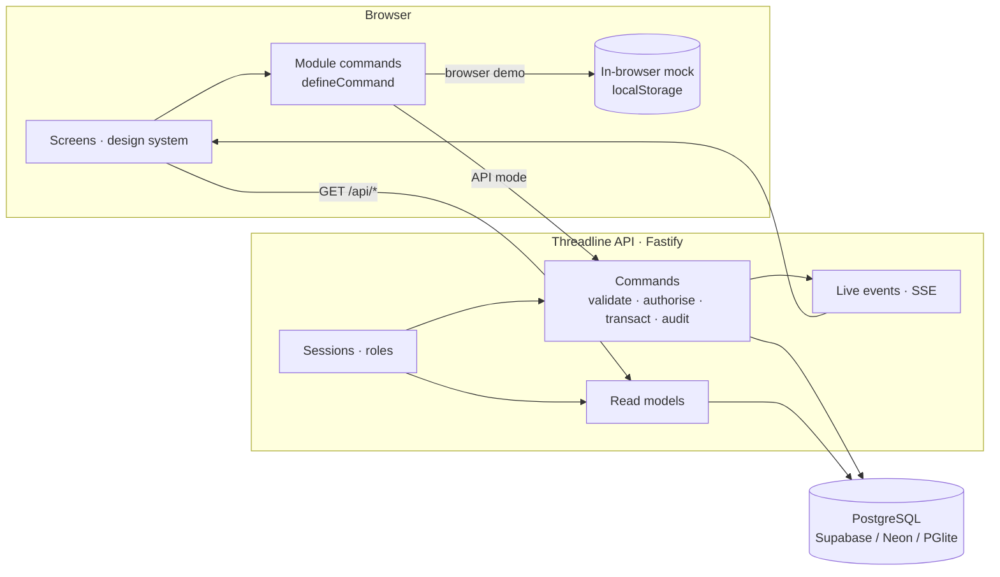

# Threadline architecture

One React front end, two ways to run it, and one API.



## Two run modes, one code base

| | Browser demo (`npm run build`) | API mode (`npm run build:api`) |
| --- | --- | --- |
| Data | Fixtures in the browser, saved to `localStorage` | PostgreSQL through the API |
| Sign-in | None; **View as** any role | Email + password, server sessions |
| Rules | Same rules, run in the browser | Same rules, run on the server in a transaction |
| Hosted on | Vercel (static) | Render (or any Node host) |

The switch is `import.meta.env.VITE_API_MODE`. Screens never branch on it: they call `api.*` for reads and module commands for writes, and the transport is chosen underneath.

## A command, end to end

Take "approve PR-0084":

1. The screen calls `api.decideApproval(id, decision, reason)`. Module-level actions call functions from `modules/<m>/commands.ts`, each declared once with `defineCommand(name, toInput, local)`.
2. **API mode:** the browser sends `POST /api/commands/approvals.decide` with JSON; the session cookie travels with it.
3. The server resolves the session to an **actor** (user, role, permissions), checks the command's module level, and validates the input with Zod.
4. The command runs in **one database transaction**. It locks the rows it changes (`SELECT … FOR UPDATE`), applies the business rules (here maker ≠ checker, the designated approver role, and a reason required to reject), and writes an **audit event**.
5. After commit, the server **broadcasts** a change event to every other session allowed to view the module. Their screens refetch and show who acted.
6. Errors come back as `{ error: { code, message } }` with `VALIDATION` 400, `UNAUTHENTICATED` 401, `FORBIDDEN` 403, `NOT_FOUND` 404 or `BLOCKED` 409. The message is written for the person who caused it, and screens show it in place.

## Security model

- **Passwords:** bcrypt. **Sessions:** 32-byte random tokens in an httpOnly, SameSite=Lax cookie; only their SHA-256 is stored.
- **Lockout** after five failed attempts per account, plus a per-IP sign-in ceiling. Unknown emails and wrong passwords get the same answer.
- **Permissions** are role × module × level (`none` < `view` < `edit` < `approve` < `admin`), checked on every read and command. Approvals add a designated approver role, and maker ≠ checker.
- **Cross-site requests:** state-changing calls must be JSON from the site's own origin.
- **Headers:** `X-Content-Type-Options`, `X-Frame-Options: DENY`, `Referrer-Policy`.
- **TLS to the database** is always certificate-verified; Supabase's CA ships in `server/certs/`.
- **Secrets** live only in git-ignored files (`server/.env`, `*.local.md`) or the host's environment.

## Data model

Relational tables, keyed by the human record IDs (`PRJ-0264`, `ITM-0137`), so every link in the UI is a foreign key. Child collections are tables (milestones, BOM lines, work-order stages, PO lines, quotes, subcontract lines, exit items). Money is whole rupees (`bigint`), dates are `date`, events are `timestamptz`.

- **Invariants in the database:** CHECK constraints keep stock non-negative, receipts within the ordered quantity, subcontract accounting within the issued quantity, and outbox states to a known set. They hold even if application code has a bug.
- **Record IDs** come from a row-locked `id_sequences` table, so concurrent creates never collide.
- **Audit:** `audit_events` is append-only and readable in Users & Access → Audit.
- **Migrations:** `server/drizzle/`, generated by drizzle-kit and applied on start.

## Where things live

```
prototype/src/
  ds/          design system (tokens, components)
  api/         types · fixtures · mock · http · session · live · hooks
  app/         shell · router · sign-in · demo guide · shared patterns
  modules/     one folder per module (pages, views, commands.ts)
  showcase/    product site
server/src/
  db/          schema · client (pg or PGlite) · seed · reset · migrate
  commands/    operations · commercial · custody (+ registry)
  read.ts      read models in the front end's shapes
  auth.ts      sign-in, sessions, profile
  live.ts      server-sent events and presence
  app.ts       routes, guards, errors
server/test/   API and database tests (in-memory PostgreSQL)
```
